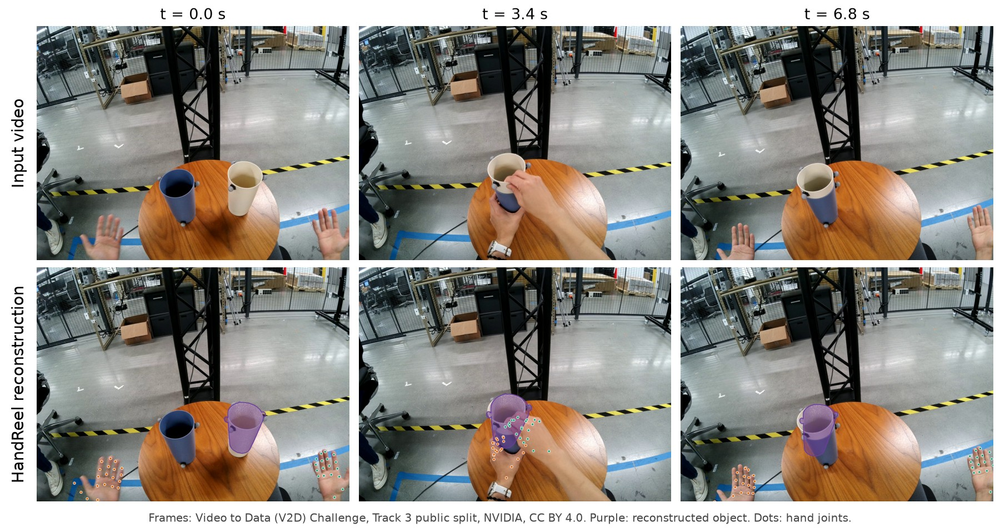

<div align="center">
<h1>HandReel: Fast Hand-Object Reconstruction from Video without Per-Frame Pose Sampling</h1>

[Shi Chen](https://shichen.world/)<sup>1,2</sup>, [Jeffrey Ichnowski](https://ichnow.ski/)<sup>1</sup>

<sup>1</sup>[Robotics Institute, Carnegie Mellon University](https://www.ri.cmu.edu/) &nbsp;&nbsp; <sup>2</sup>[Intuition](https://intuition.dev/)


<a href="LICENSE"></a>

</div>



## Citation

`CITATION.cff` and the entry below cite the paper, "HandReel: Fast Hand-Object Reconstruction from Video without
Per-Frame Pose Sampling". Please also cite DO AS I DO (arXiv 2606.19333) and the models
you use (SAM 2, SAM 3D, MoGe-2, CoTracker3, HaWoR, WiLoR, MANO, Hands23).

```bibtex
@misc{chen2026handreel,
  title  = {{HandReel}: Fast Hand-Object Reconstruction from Video without Per-Frame Pose Sampling},
  author = {Chen, Shi and Ichnowski, Jeffrey},
  year   = {2026}
}
```

## Overview

HandReel takes a short video of a hand using an object. It returns the object's shape, its pose in every processed
frame and its metric scale, with the motion of the right hand in the frames where the hand estimator finds it. The
picture shows the reference result that ships with this repository, drawn over three frames of a public clip (see
"Expected output").

HandReel (Python package `fastdo`) is a staged engine (decode, mask, shape, intrinsics, hands, geometry, tracks, solve,
then the optional qc and retarget stages), configured with Hydra (`run/conf/config.yaml`). The mask, shape, intrinsics,
hands, geometry and tracks stages use pinned pretrained models (SAM 2.1, SAM 3D Objects, MoGe-2, HaWoR, CoTracker3).
Each stage writes its artifacts per window. The solve stage fits the object's poses and scale over the window. [`release/MODELS.md`](release/MODELS.md) lists the external
files for the released reconstruction configurations, their sources and licensing information, and the SHA-256 hashes
recorded on the authors' system. The release also contains research code for retargeting to a robot hand
and for physics-based tracking; these do not yet run from this release (see ["Known gaps"](#known-gaps)).

## Quick start

The fastest check needs no GPU and no model weights. A full run needs the installation and the weights below.

### Try it on CPU, no weights

The shipped reference reconstruction of the clip above opens in your browser, in 3D over the video's frames. It needs
no GPU, model weights or MANO. Unpack the release archive and work from its `handreel/` directory:

```bash
tar -xzf handreel-release-*.tar.gz && cd handreel
uv sync --frozen --python 3.12 --extra dev --extra frontend --extra viser
uv run --frozen hf download nvidia/video_to_data_challenge \
  track_3/public/videos/chunk-000/observation.images.ego_cam_a/episode_000011.mp4 \
  --repo-type dataset --revision 5f68335f3acc802033d1e80728c1633197521de8 --local-dir data/example
uv run --frozen --extra viser python scripts/view_clip.py release/reference/v2d_t3_ep011_cam_a \
  --video data/example/track_3/public/videos/chunk-000/observation.images.ego_cam_a/episode_000011.mp4
```

Open the printed URL (<http://127.0.0.1:8080>; pass `--port N` if 8080 is taken); Ctrl-C stops it. The clip is CC BY 4.0 (V2D Challenge, NVIDIA).
If you supply a local copy of the clip, compare its SHA-256 with the one in `release/example/example_input.json`.
The viewer pairs frames by index and accepts any readable video that contains those indices.

**Viewer time is not reconstruction time.** The viewer draws a reconstruction that already exists, so the time it
takes to load and draw is viewer time. The GPU example of "Quick start" logs its reconstruction seconds apart from
any viewer time.

### Installation

Requirements: Linux x86_64, Python 3.12, [uv](https://docs.astral.sh/uv/), conda, `git`, and `ffmpeg` with `ffprobe`
on `PATH`. The model stages need an NVIDIA GPU with at least 24 GB of memory; the code was developed on one H100 80 GB
with CUDA 12.8 wheels, and only that build was tested. A cold build needs about 60 GB of disk before the weights.

```bash
cd handreel                              # the unpacked release archive
bash scripts/fetch_baseline.sh           # DO AS I DO at the pinned commit, into third_party/
bash scripts/setup_all.sh --dry-run      # prints every step of release/QUICKSTART.md step 2
bash scripts/setup_all.sh                # builds them: the uv env, the sam3d and hawor conda envs, HaWoR
```

`setup_all.sh` needs conda on `PATH`, or `FASTDO_CONDA_BASE` set to your conda or miniforge root. It clones HaWoR to
`../hawor`, next to this checkout. On a GPU other than an H100, set `TORCH_CUDA_ARCH_LIST` first (for example `8.0`
on an A100).

The GPU example (`release/example/run_example.py`) needs exactly these four variables:

- `FASTDO_GPU_MEM_GB=32`;
- `FASTDO_CONDA_BASE`;
- `FASTDO_SAM3D_PYTHON`;
- `FASTDO_HAWOR_ROOT`.

For a CPU-only look, `uv sync --frozen --python 3.12 --extra dev --extra frontend --extra viser` builds only the
main environment.

[`docs/installation.md`](docs/installation.md) has the rest: the environments and why there are several, every
host path and environment variable, the flash_attn requirement on A100, H100 and H200 cards, and the notes on
building by hand. `release/QUICKSTART.md` walks through every step and says which commands were run for this release.

### Weights

`scripts/fetch_weights.py` pins every model to a revision and verifies each published sha256; it never writes under
`third_party/`.

```bash
uv run --frozen python scripts/fetch_weights.py            # the table: source, revision, licence, sha256
uv run --frozen hf auth login                              # after accepting SAM 3D's terms on Hugging Face
uv run --frozen python scripts/fetch_weights.py --yes \
  --only sam2,moge2,sam3d,moge1_sam3d,dinov2_sam3d,cotracker3,hawor,wilor_detector --hawor-root ../hawor
```

`../hawor` is the HaWoR checkout that `scripts/setup_all.sh` cloned ("Installation"); pass yours if it is elsewhere.
`--yes` means you accept the licence of each model you fetch; several are non-commercial (see "Licence"). SAM 3D
Objects is gated on Hugging Face.

**MANO** is never downloaded or shipped. Register at <https://mano.is.tue.mpg.de>, accept the licence
(<https://mano.is.tue.mpg.de/license.html>; non-commercial, no redistribution), put `MANO_RIGHT.pkl` and
`MANO_LEFT.pkl` in `FASTDO_MANO_DIR` and `FASTDO_MANO_LEFT_DIR`, and copy them into the HaWoR checkout
(`release/QUICKSTART.md` step 3).

[`docs/weights.md`](docs/weights.md) lists every model with its licence, whether commercial use is allowed and how
to get it. `release/MODELS.md` adds the pinned revision and sha256 of every file, and `THIRD_PARTY_LICENSES.md` the
licence texts.

### Run the example on a GPU

On CPU, with only the main environment, these run without weights, data or a GPU:

```bash
uv sync --frozen --python 3.12 --extra dev --extra frontend --extra viser
export CUDA_VISIBLE_DEVICES=
uv run --frozen pytest -q -m "not slow and not timing" \
  tests/release tests/test_package.py tests/test_hostpaths.py tests/run/test_build_hoi4d_hands.py tests/reproduce
uv run --frozen python run/pipeline/bench_throughput.py --cfg job > /dev/null
uv run --frozen python release/example/run_example.py --stub --video README.md --out outputs/example_stub
PYTHONPATH=src uv run --frozen python -m fastdo.audit.example outputs/audit_example
```

In order: a CPU subset of the test suite; Hydra config composition for the benchmark entry point without running it; the
example runner with every stage replaced by a placeholder (argument parsing, config loading, orchestration and output
schema only; in stub mode `--video` is never decoded, so any existing file works as a placeholder, here
`README.md`); and the physics-certificate audit (`docs/audit.md`) on a synthetic scene. The stub's stage artifacts are
empty placeholder files (0 bytes) and its seconds are not timings; the run also leaves an empty `engine/.gpu.lock`
(`docs/output.md`). To look at a real reconstruction on CPU, open the
reference output of "Interactive viewer". The whole CPU suite is `uv run --frozen pytest -q -m "not slow and not timing"`
(about 30 min on a 4-thread cap; measured on the development host); GPU tests are faked or skip, as do tests whose
dataset, conda env or baseline checkout is absent.

On a GPU, with the environments, weights and MANO in place and the four variables the GPU example needs ("Host
paths") set:

```bash
export CUDA_DEVICE_ORDER=PCI_BUS_ID CUDA_VISIBLE_DEVICES=0   # the one card to use, numbered as /proc lists them
FASTDO_GPU_MEM_GB=32 uv run --frozen --extra dev --extra frontend \
  python release/example/run_example.py --out outputs/example --card dedicated
```

It replaces `outputs/example/engine/<clip>/` and the report on every run, so use a fresh `--out` per run you want to
keep. The two exports make the report name the card the run used (`release/QUICKSTART.md` step 4). Before any GPU
work the script checks that CoTracker3, the SAM 3D Objects files and MANO are in place and names whatever is
missing. At the end it logs the reconstruction time on your machine (the stage sum of this one cold window); viewer
time is not part of it, and no ratio to another method is computed. That sum covers the eight stages only, model
loading included. The SAM 2.1 box-to-mask prompt before the stages, the clip download, interpreter and uv start-up
and report writing fall outside it (about 11-12 s in one independent run). That boundary differs from every row of
the paper's Table 2 ([`docs/paper_exhibits.md`](docs/paper_exhibits.md), "Timing boundaries"). The shipped reference run has a stage sum of
60.3 s, and the Quickstart's "Run-to-run variation" paragraph gives the ranges that the authors report over six cold
runs.
It downloads one CC BY 4.0 clip (V2D Challenge Track 3 public split, at a pinned revision) and reconstructs it;
`release/QUICKSTART.md` step 4 describes the clip, the camera handling and the outputs. One run of this command on
an H100 produced the reference output in `release/reference/v2d_t3_ep011_cam_a/` (its README says how, and what was
left out).

### Expected output

On the example clip a successful run puts the object mesh on the beige cup and the hand points on the hands. The
picture at the top of this page is the shipped reference output at decode rows 0, 34 and 68, drawn over the clip's
frames (CC BY 4.0, V2D Challenge Track 3, NVIDIA) by `scripts/render_reference_png.py`. The PNG projects the solve poses. The interactive viewer uses contact-refined poses when available. To draw the same picture for your own run, after the clip has been downloaded:

```bash
uv run --frozen python scripts/render_reference_png.py outputs/example/engine/v2d_t3_ep011_cam_a --out my_run.png
```

It reads the frames from `decode.npz` (pass `--video` for a directory without it). Compare by eye: the overlay
should sit on the same pixels. It is not a numeric tolerance.

## Detailed usage

### Run on your own video

Write an input description for your clip, starting from `release/example/spec_template.json`: `clip_id`, `domain`
(`egocentric` or `third_person`), the video's `fps`, `n_frames`, `width` and `height` (the template's `_note` gives the
`ffprobe` command), the `window` in source frames (about 10 s at most), a `keyframe` inside it and a `box_xyxy` around
the object on that keyframe, in source pixels. The keyframe must be a frame the run decodes (every third frame from
the window start at 30 fps); otherwise the example stops before any model loads and names the nearest decoded frames. Then, on a GPU with the same setup as the example:

```bash
cp release/example/spec_template.json my_clip.json                   # then edit it for your video
FASTDO_GPU_MEM_GB=32 uv run --frozen --extra dev --extra frontend \
  python release/example/run_example.py --spec my_clip.json --video my_clip.mp4 --out outputs/my_clip --card dedicated
uv run --frozen --extra viser python scripts/view_clip.py outputs/my_clip/engine/my_clip
```

The last path is `<--out>/engine/<clip_id>/`. With `--spec`, nothing is downloaded and no sha256 is checked; the
script checks the spec's width and height against the file and exits with a one-line message on any input error.
`ATTRIBUTION.txt` then names no dataset: your video's licence and attribution are yours to state. The camera is
estimated per clip by MoGe-2, as for the example. Add `--stub` to check a spec on CPU without a model: it checks the
spec itself (its fields, window and keyframe, and the box inside the frame) but not its width and height against the
file, which only a GPU run probes.

### Input

- One or more windows of monocular RGB video (an mp4 file and a frame range), decoded at the working rate.
- A box on the manipulated object at one keyframe. For internet video, the opt-in prompt stage (Hands23 detector)
  proposes the keyframe and its box instead.
- Model weights (fetched by `scripts/fetch_weights.py`) and your own MANO files (never fetched or shipped).

`release/example/example_input.json` is a complete input description for one public clip. The clip is downloaded at
a pinned revision on first use; it is not shipped.

### Output

Per window, the run writes a directory `<bench.artifact_root>/<clip_id>/` (default `outputs/engine/<clip_id>/`) with
one artifact per stage (`decode.npz` to `solve.npz`, plus `mesh.obj`) and `profile.json`. The object's pose per frame
and its metric scale are in `solve.npz`; the hands are in `hands.npz`, in the camera of `intrinsics.npz`. The shipped
example stops at `solve.npz` (see ["Known gaps"](#known-gaps)). [`docs/output.md`](docs/output.md) gives the stage layout and the fields
and coordinate conventions of the solve and hand outputs.

## Interactive viewer

`scripts/view_clip.py` serves one clip directory in the browser (Viser, on 127.0.0.1): the object mesh and the hands
in 3D over the source frame of the same frame id, with play/pause, a frame slider and orbit (drag; scroll to zoom).
It needs the `viser` extra (in the CPU `uv sync` above) and no GPU. The shipped reference output, on CPU:

```bash
uv run --frozen --extra viser python scripts/view_clip.py release/reference/v2d_t3_ep011_cam_a
```

Open the printed URL (default <http://127.0.0.1:8080>; `--port N` changes it); Ctrl-C stops the server. To show the source frames in the
viewer, supply the matching clip with `--video` (download command in
`release/reference/v2d_t3_ep011_cam_a/README.md`). The PNG preview includes three source stills. Its hands are drawn as their 21 joints (right green, left
orange, as in the picture above), because the MANO mesh arrays (vertices and faces) are not shipped. Your own GPU run has `decode.npz` and the full hand arrays, so the viewer
shows its frames and hand meshes. The frame slider counts decode rows from 0, as the rest of this page does:

```bash
uv run --frozen --extra viser python scripts/view_clip.py outputs/example/engine/v2d_t3_ep011_cam_a
```

## Results in the paper

Selected results, in the words and with the status that the submitted paper gives each. [`docs/paper_exhibits.md`](docs/paper_exhibits.md)
maps each number to its table, figure or section; some rest on the paper's prose alone.

- **Error on held-out data (object-centre error).** Across 58 analysed held-out HOI4D windows with ground-truth
  object prompts, the paired object-centre error ratio of HandReel to DO AS I DO was 0.50 under the registered failure
  rules, in which a failure to deliver counts as an error (Table 1). On DexYCB, HandReel's ratio was 0.85, which is non-inferior, but that verdict is not robust if
  joint failures count against HandReel, and the authors partly used this subject in development (Table 1).
- **Reconstruction time, one window at a time (Table 2, row 1).** On Ego4D, on one H100 on a shared host with
  a 17-core CPU quota, the paper timed both pipelines one window at a time. DO AS I DO's reconstruction stage took about 30x as long as HandReel: about
  2,000 s against 66 s per window, on 20 windows. The study drew 74 windows; both pipelines completed 25, and the
  paper analyses 20 of them, without 5 that an audit of the timed processes' CPU affinity and a screening of CPU
  use flagged. It prints the lower of the readings on 25 and 20 windows, by a rule that the authors set after the
  study ended and before they computed estimates. A window counts as completed when DO AS I DO finishes
  and HandReel's solve runs, even if HandReel's quality check then rejects it. The bracket that Table 2 prints,
  25 to 37, is an envelope.
- **Reconstruction time, the baseline restarts against HandReel's share of batched runs (Table 2, row 2).** The
  paper timed DO AS I DO's reconstruction stage with a restart for every window: 2,100 s per window. HandReel's side
  is not the time of one window alone. It is a 17 s per-window share: the mean wall time of batched runs, which the
  paper splits among windows in proportion to their stage seconds. Each batched run loaded its models once, and the
  timing includes that load. The ratio is 130x, with a 95% confidence interval of 97 to 170, on the 9 of 19
  attempted windows that both pipelines completed, which is below the registered minimum of 10.
- **Reconstruction time, both in batched runs, where the paper models the baseline (Table 2, row 3).** The
  baseline's seconds in this row are a modelled value, about 1,600 s per window: the paper models two instances of
  DO AS I DO that run at once, with the 1.2x throughput gain that two instances showed on three window pairs.
  HandReel's side is a 14 s per-window share of its batched runs. The modelled ratio is about 120x, on the 20
  completed windows that the paper analyses; the bracket that Table 2 prints, 87 to 150, is an envelope.
- **One video through the full pipeline (Table 5).** By a sum of separately measured stage times, DO AS I DO's full
  pipeline would take about 3x as long per window with its own reconstruction as with HandReel's: 3,069 s against
  991 s. This comparison times neither pipeline end to end. The reconstruction terms of the sums are the 2,100 s
  and the 17 s per-window share of Table 2, row 2. HandReel's sum also holds 2.63 CPU core-seconds for the
  certificate check. Both sums share one 894 s physics time and neither holds a gravity term. The 894 s is the median
  elapsed time of one planner arm, which the authors measured only after HandReel's reconstruction, at 2 perturbation
  samples (default 4), while two planner arms ran at once on the same GPU. It is not a time for one arm alone on the
  GPU. With HandReel reconstruction, physics is the largest term in the stage sum.

- **Orientation (Sec. 5.2).** Object-centre error ignores orientation. Both pipelines delivered 13 of the 25
  evaluated DexYCB views of objects without symmetry. On those 13 views, HandReel had the higher median rotation
  error.
- **Published methods on HO3D-v3 (Table 3).** Table 3 lists published timings for six methods beside the
  measured Ego4D times. AGILE reports the times for HOLD and MagicHOI. AGILE reports HOLD and MagicHOI accuracy on
  successful sequences (100.0% and 83.3% succeeded, respectively). Each published timing uses its source's own
  input, hardware and timing scope. On HO3D-v3, five of them (HOLD, MagicHOI, AGILE, Open-CHOIR and 4D-HOF) have a
  lower Chamfer distance, in the values that the 4D-HOF paper lists, than the paper measured for HandReel. The
  listed and the measured errors use different inputs and evaluation protocols, so they are not a paired ranking.

Table 2 computes each ratio as the baseline's seconds over HandReel's, from unrounded seconds, so dividing the
printed seconds need not give the printed ratio. For each row of Table 2, the supplement describes the windows
included in the row and explains how each time was obtained (the supplement, Additional Experiments).

Ego4D has no ground-truth object poses, so the Ego4D timing studies measure speed only. HandReel ran the held-out
test from one frozen code tree and both timing studies from a later one, and the authors did not compare the outputs
of the two trees (the supplement, Experiment Details). This release cannot rerun these studies.

## Evaluation

Most of the paper's records are not in this release, and no script here reruns a paper experiment. Two checks run
from this release:

- `python3 reproduce/regenerate_tables.py --out <new or empty dir>` checks all 14 aggregate-only records in
  `reproduce/records/`, which are proposed for release and await the authors' decision. It uses ten of them to
  write four tables of the paper source's table generator and writes a fifth from settings in the generator. It
  compares the five outputs with that generator's output at a pinned paper-source revision, ignoring comment lines. None of
  the five is a table of the submitted main paper, whose Tables 1 to 5 the paper source writes by hand.
- With per-unit errors that you regenerate after acquiring HOI4D and DexYCB,
  `reproduce/e1_verdict_from_scores.py` recomputes the error ratios, intervals and median errors of Table 1
  (`reproduce/heldout/README.md`).

[`reproduce/README.md`](reproduce/README.md) says what each check covers, and [`docs/paper_exhibits.md`](docs/paper_exhibits.md) maps every exhibit of the submitted
main paper to what this release holds toward it.

The benchmark entry point runs the reconstruction on DO AS I DO's whisking demo clip (from the baseline submodule). As
configured, it reruns 3 identical windows of that one clip:

```bash
FASTDO_GPU_MEM_GB=32 uv run --frozen --extra dev --extra frontend \
  python run/pipeline/bench_throughput.py paths.root=$PWD \
  'bench.stages=[decode,gate,mask,shape,intrinsics,hands,geometry,tracks,solve]'
```

The demo supplies the baseline clip, its SAM 3D object mesh and the pre-optimization keyframe layout. Before timing,
the runner projects the mesh to make one silhouette prompt for all three copies.

It logs a clips-per-GPU-hour figure. The logged rate divides the attempted copies by the summed stage hours, CPU stages
included; a copy that stops early contributes only its partial time. That figure is smoke throughput on duplicated windows, not an evaluation: the
three windows are the same clip, nothing is scored, and it is not comparable with the paper's reconstruction times. On this
clip the depth-anchor gate flags all three solves (the log reports FLAGGED; in one independent run it moved 31 of 46
frames, by up to 0.51 m), so do not read the benchmark's output as a reconstruction of good quality either.

The `qc` stage needs a fitted acceptance rule (`run/pipeline/calibrate_acceptance.py`, then
`qc_stage.rule_path=<rule>`); retarget is opt-in and runs only on qc-accepted windows (`retarget` in `bench.stages`,
`retarget_stage.enabled=true`). Physics tracking runs in DO AS I DO's `retargeting` env.

**Datasets.** None are redistributed. DexYCB (CC BY-NC 4.0), HOI4D, HO3D-v3, OakInk2, Ego4D and 100DOH each have their
own terms; obtain them from their owners. `run/data/` holds manifests and two downloaders (`download_dexycb.py`;
`download_100doh.py`, which fetches YouTube clips: you are responsible for complying with YouTube's Terms of Service
and the videos' copyright).

## Repository layout

```
run/conf/          Hydra configs
run/pipeline/      entry scripts (benchmark, data builders, calibration, evaluation)
run/paper/         e1_table.py: the paper's held-out-test macros from the verdict record
run/study/         e1_stats.py: the held-out-test estimator (no other study script is in this release)
run/robot/         Unitree G1 package export
run/setup/         baseline environment setup
run/data/          dataset manifests and downloaders
src/fastdo/        the package
packages/          alongray and nullaudit, standalone packages with their own LICENSE and NOTICE (uv sync: nullaudit only)
release/           pinned worker-environment locks, the weights manifest, a one-clip example and its reference output
reproduce/         the table regeneration check and its records; the held-out test's protocol, unit IDs and verdict check
scripts/           setup_all.sh, fetch_baseline.sh, fetch_weights.py, view_clip.py, render_reference_png.py, dependency_licences.py,
                   check_paper_quotes.py (cited paper numbers and wording patterns against the main PDF; not a claim check)
docs/              the audit tool, the timing protocol, the paper exhibits and the record names
licenses/          licence texts of the third-party code adapted here
third_party/       DO AS I DO official code as an unmodified git submodule (empty in the release tar)
tests/             pytest suite
```

`VERSION` reads `$Format:%H %cs$` in a git clone. Only `git archive` exports, such as the release tar, fill it in with
the commit and its date (`.gitattributes`: `export-subst`); in a clone, `git rev-parse HEAD` gives the commit.

## Acknowledgements

The reconstruction builds on DO AS I DO, SAM 2, SAM 3D Objects, MoGe, HaWoR, WiLoR, CoTracker3, MANO and Hands23, and
the physics code on MuJoCo and MuJoCo-Warp; `THIRD_PARTY_LICENSES.md` credits each with its licence.

## Known gaps

- The reference output (`release/reference/v2d_t3_ep011_cam_a/`) comes from a run with CoTracker3 at its pinned
  commit and a `sam3d` env completed by `release/QUICKSTART.md` step 2's flash_attn and `sam3d_objects` commands, but
  its `hawor` env, weights and MANO were the development host's. An independent run on envs built from nothing by
  `scripts/setup_all.sh` reproduced its stage artifacts, timing fields excluded, but with SAM 3D weights and MANO files copied
  from an existing host: the gated SAM 3D download itself has not been tested.
- No acceptance rule fitted for new video ships, so the qc and retarget stages (and so retargeting to a robot hand)
  cannot run from this release as is; there is no shipped path from an engine clip directory to a physics run.
  `reproduce/heldout/qc_rule_constants.json` holds the constants of the QC rule the held-out test registered, as a
  record of that test. The authors fitted it on 71 DexYCB development clips with ground-truth template meshes, and
  its five-fold cross-validated area under the curve on those clips was 0.4904, where 0.5 is chance (the supplement,
  Limitations). It is not a usable acceptance rule for new video.
- This release is a later commit of the code than both the tree frozen for the held-out test and the tree timed in
  the Ego4D timing studies; this release shows no comparison of its outputs with either.
- No script in this release reruns a paper experiment; [`docs/paper_exhibits.md`](docs/paper_exhibits.md) says what this release holds toward
  each exhibit, and [`reproduce/README.md`](reproduce/README.md) lists the gaps.
- No container image.

## Licence

Our code is Apache-2.0 (`LICENSE`, `NOTICE`). `packages/alongray` and `packages/nullaudit` carry their own `LICENSE` and
`NOTICE`. **The derived data files are not Apache-2.0**: `reproduce/heldout/` (unit IDs derived from HOI4D and DexYCB, CC
BY-NC 4.0: non-commercial use only; no per-unit error against their ground truth ships) and the reference output in `release/reference/` (derived from a CC BY 4.0 clip; its
hand arrays are HaWoR outputs on the MANO model and follow HaWoR's CC BY-NC-ND 4.0 and MANO's licence). We do not ship
MANO-derived meshes: the reference's hand vertices and faces are left out. `THIRD_PARTY_LICENSES.md`, "Derived data in
this repository", lists each file and its terms. The repository includes code adapted from DO AS I DO (MIT), MoGe (MIT) and SAM 3D Objects (SAM License: two
short expressions, and an adaptation of its mesh postprocess in `src/fastdo/shape/fast_postprocess.py`); each such file
says so in its header, and `THIRD_PARTY_LICENSES.md` lists them with the licence texts in `licenses/`. **We ship no
weights, MANO files or datasets.** `THIRD_PARTY_LICENSES.md` lists every model, runtime, robot asset and Python
dependency with its version and licence. Read it before use:

- **Non-commercial components in the default pipeline:** HaWoR (CC BY-NC-ND 4.0), the WiLoR detector (NC; NC-ND on the
  stricter reading), smplx (MPI non-commercial), MANO (non-commercial, no redistribution, no commercial training),
  CoTracker3 (CC BY-NC 4.0), the Hands23 weights (no licence text, NC training data), and in the shape stage
  nvdiffrast 0.4.0 (NVIDIA Source Code License, non-commercial) and kaolin 0.18.0 (its `non_commercial` package). As
  shipped, the pipeline and the data it produces are for non-commercial research only: the outputs are bound by these
  model licences too.
- **Copyleft packages imported at run time:** these files are Apache-2.0, apart from the SAM-adapted parts of
  `src/fastdo/shape/fast_postprocess.py`, which stay under the SAM License (THIRD_PARTY_LICENSES.md). They import,
  at run time, ultralytics
  (AGPL-3.0) in the HaWoR process, and pymeshfix (GPL-3.0), igraph (GPL-2.0-or-later) and plyfile (GPL-3.0-or-later)
  in the SAM 3D worker process. None of them is included or modified here. If you distribute a combined work, their
  copyleft terms apply to it. libigl is MPL-2.0: its sections 3.1 and 3.2 set the terms for distributing libigl's own files, in source or
  executable form and modified or not; that copyleft is per file and does not reach this project's files.
- **The DINOv2 code SAM 3D loads** (torch.hub, commit `7764ea0f`): the backbone code and weights are Apache-2.0; at
  that commit `hubconf.py` also imports the Cell-DINO modules, whose files state CC BY 4.0 and CC BY-NC. SAM 3D calls
  only `dinov2_vitl14_reg` and loads no Cell-DINO weights.
- **Robot assets:** the Sharpa Wave hand assets inside DO AS I DO carry no licence file; this repository ships none of
  them, and its outputs hold joint trajectories, not the meshes or XML.
- **Non-commercial baselines and ablations** (evaluation only; not in the default pipeline, never shipped):
  FoundationPose (NVIDIA Source Code License, non-commercial) and Open-CHOIR's assets.
- The example clip is from the V2D Challenge Track 3 public split (NVIDIA, CC BY 4.0); `release/example/run_example.py`
  writes the attribution its outputs need (`ATTRIBUTION.txt`).
- The conda locks of `release/env/` fetch from `repo.anaconda.com`, so Anaconda's Terms of Service apply to those
  packages.

This section states what the licence texts say as we read them. It is not legal advice.
