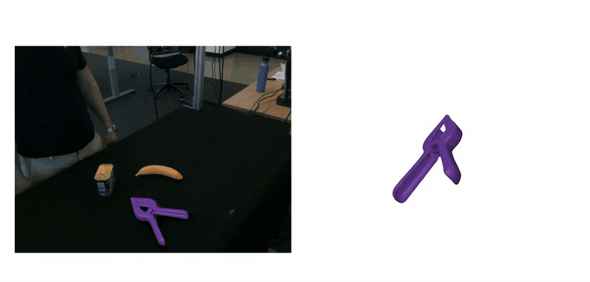

<div align='center'>
<h1>HandReel: Fast Hand-Object Reconstruction from Video without Per-Frame Pose Sampling</h1>

[Shi Chen](https://shichen.world/)<sup>1,2</sup>, [Jeffrey Ichnowski](https://ichnow.ski/)<sup>1</sup>

<sup>1</sup>[Robotics Institute, Carnegie Mellon University](https://www.ri.cmu.edu/) &nbsp;&nbsp; <sup>2</sup>[Intuition](https://intuition.dev/)

<a href='https://shichen.world/HandReel/'></a>&nbsp;
<a href='https://shichen.world/HandReel/#video'></a>&nbsp;


<a href='LICENSE'></a>

</div>

<p align='center'>
<a href='https://shichen.world/HandReel/#video'></a>
<br>
<sub><b>Click the animation for the full narrated video (about 5 min) on the project page.</b> Silent 17 s excerpt of that video: HandReel's 3D reconstruction of a DexYCB development clip, the Ego4D reconstruction time per window (DO AS I DO's reconstruction stage restarts for every window; HandReel's time is its share of a batched run), and the summary. Frames from DexYCB (CC BY-NC 4.0); see <a href='DATA_NOTICES.md'><code>DATA_NOTICES.md</code></a>.</sub>
</p>

**TL;DR**: HandReel recovers a hand-held object's 3D mesh and 6-DoF motion from monocular video, 30-130x faster than DO AS I DO's reconstruction stage (30x one window at a time, 130x batched), with half its median object-centre error on held-out HOI4D.

## News

- **2026-11-20**: Code released.

## Overview

HandReel reconstructs a hand-held object from a monocular video. It works on windows, short stretches of
consecutive frames (up to about 10 s in the paper's experiments). For each window it builds one 3D mesh of the
object from one frame, follows points on the object through the video for a first guess of its motion, and then
refines all positions and the object's real-world size together. The scale comes from the estimated right hand. It
returns the mesh, its position and rotation over time and its scale, with the right hand where the hand estimator
finds it.

The Python package is `fastdo`, configured with Hydra (`run/conf/config.yaml`); [`docs/development.md`](docs/development.md)
describes its stages. The release also contains research code for retargeting to a robot hand and for physics-based
tracking; these do not yet run from this release (see ["Known gaps"](#known-gaps)).

<sub>On the name: HandReel's code keeps its working name, `fastdo`, for the package, the `FASTDO_*` variables and the commands; only the method is called HandReel.</sub>

## Quick start

The fastest check needs no GPU and no model weights. A full run needs the installation and the weights below.

### Try it on CPU, no weights

The shipped reference reconstruction of the example clip opens in your browser, in 3D over the video's frames. The
example clip is a public V2D Challenge Track 3 video; it is not one of the six clips in the picture at the top. This
needs no GPU, model weights or MANO. Clone the repository and work from its root:

```bash
git clone https://github.com/BillyChern/HandReel && cd HandReel
uv sync --frozen --python 3.12 --extra dev --extra frontend --extra viser
uv run --frozen hf download nvidia/video_to_data_challenge \
  track_3/public/videos/chunk-000/observation.images.ego_cam_a/episode_000011.mp4 \
  --repo-type dataset --revision 5f68335f3acc802033d1e80728c1633197521de8 --local-dir data/example
uv run --frozen --extra viser python scripts/view_clip.py release/reference/v2d_t3_ep011_cam_a \
  --video data/example/track_3/public/videos/chunk-000/observation.images.ego_cam_a/episode_000011.mp4
```

Open the printed URL (<http://127.0.0.1:8080>; pass `--port N` if 8080 is taken); Ctrl-C stops it. The clip is CC BY
4.0 (V2D Challenge, NVIDIA). The viewer shows the object mesh and the hands over the source frames, with play/pause,
a frame slider and orbit. For the reference output it draws the hands as their 21 joints, because the MANO mesh
arrays are not shipped; your own GPU run shows hand meshes. To check the installation on CPU without weights (a test
subset and a stub run of the example), see [`release/QUICKSTART.md`](release/QUICKSTART.md), "CPU checks without
weights".

### Installation

**What you need.**

| Requirement | Detail |
|---|---|
| OS | Linux x86_64 |
| GPU memory | one NVIDIA GPU with at least 24 GB; only one H100 80 GB with CUDA 12.8 wheels was tested |
| Disk | about 60 GB for a cold build, plus about 25 GB of weights (`release/QUICKSTART.md`) |
| Accounts | a MANO registration, and a Hugging Face login that has accepted the gated SAM 3D Objects terms |

Requirements: Linux x86_64, Python 3.12, [uv](https://docs.astral.sh/uv/), conda, `git`, and `ffmpeg` with `ffprobe`
on `PATH`. The model stages need an NVIDIA GPU with at least 24 GB of memory; the code was developed on one H100 80 GB
with CUDA 12.8 wheels, and only that build was tested. A cold build needs about 60 GB of disk before the weights.

```bash
git clone https://github.com/BillyChern/HandReel && cd HandReel   # skip if you cloned it above
bash scripts/fetch_baseline.sh           # DO AS I DO at the pinned commit, into third_party/do-as-i-do
bash scripts/setup_all.sh --dry-run      # prints every step of release/QUICKSTART.md step 2
bash scripts/setup_all.sh                # builds them: the uv env, the sam3d and hawor conda envs, HaWoR
```

`fetch_baseline.sh` clones DO AS I DO into `third_party/do-as-i-do`, checks out commit
`824591b808c342b20079c3b4198a8c2bdf88c74e` with the baseline's own submodules, and verifies them; it works the same
in an archive without git metadata. `setup_all.sh` needs conda on `PATH`, or `FASTDO_CONDA_BASE` set to your conda or
miniforge root; it clones HaWoR to `../hawor`, next to this checkout.

The GPU example needs exactly four variables: `FASTDO_GPU_MEM_GB=32`, `FASTDO_CONDA_BASE`, `FASTDO_SAM3D_PYTHON` and
`FASTDO_HAWOR_ROOT`. [`docs/installation.md`](docs/installation.md) has the rest (a CPU-only install, other GPUs,
every host path and variable), and [`release/QUICKSTART.md`](release/QUICKSTART.md) walks through every step.

### Weights

`scripts/fetch_weights.py` pins every model to a revision and verifies each published sha256.

```bash
uv run --frozen python scripts/fetch_weights.py            # the table: source, revision, licence, sha256
uv run --frozen hf auth login                              # after accepting SAM 3D's terms on Hugging Face
uv run --frozen python scripts/fetch_weights.py --yes \
  --only sam2,moge2,sam3d,moge1_sam3d,dinov2_sam3d,cotracker3,hawor,wilor_detector --hawor-root ../hawor
```

`--yes` means you accept the licence of each model you fetch; several are non-commercial (see ["License"](#license)).
SAM 3D Objects is gated on Hugging Face.

**MANO** is never downloaded or shipped. Register at <https://mano.is.tue.mpg.de>, accept the licence
(<https://mano.is.tue.mpg.de/license.html>; non-commercial, no redistribution), put `MANO_RIGHT.pkl` and
`MANO_LEFT.pkl` in `FASTDO_MANO_DIR` and `FASTDO_MANO_LEFT_DIR`, and copy them into the HaWoR checkout
(`release/QUICKSTART.md` step 3). [`docs/weights.md`](docs/weights.md) lists every model with its licence.

### Run the example on a GPU

With the environments, weights and MANO in place and the four variables set:

```bash
export CUDA_DEVICE_ORDER=PCI_BUS_ID CUDA_VISIBLE_DEVICES=0   # the one card to use, numbered as /proc lists them
FASTDO_GPU_MEM_GB=32 uv run --frozen --extra dev --extra frontend \
  python release/example/run_example.py --out outputs/example --card dedicated
```

It downloads one CC BY 4.0 clip (V2D Challenge Track 3 public split, at a pinned revision), reconstructs it and logs
the reconstruction time on your machine. It replaces `outputs/example/engine/<clip>/` on every run, so use a fresh
`--out` per run you want to keep. Before any GPU work it checks that CoTracker3, the SAM 3D Objects files and MANO
are in place and names whatever is missing. `release/QUICKSTART.md` step 4 describes the clip, the camera handling,
the outputs and what the logged time includes. One run of this command on an H100 produced the reference output in
`release/reference/v2d_t3_ep011_cam_a/`.

**Expected output.** On the example clip the object mesh sits on the beige cup and the hand points on the hands.
`release/reference/v2d_t3_ep011_cam_a/expected_projection.png` shows the reference output over three of the clip's
frames. To draw the same picture for your own run and compare by eye:

```bash
uv run --frozen python scripts/render_reference_png.py outputs/example/engine/v2d_t3_ep011_cam_a --out my_run.png
uv run --frozen --extra viser python scripts/view_clip.py outputs/example/engine/v2d_t3_ep011_cam_a
```

### Run on your own video

Write an input description for your clip, starting from `release/example/spec_template.json`: `clip_id`, `domain`
(`egocentric` or `third_person`), the video's `fps`, `n_frames`, `width` and `height`, the `window` in source frames
(windows of up to 10 s, as in the paper; longer windows are untested), a `keyframe` inside it and a `box_xyxy` around
the object on that keyframe, in source pixels. The keyframe must be a frame the run decodes (every third frame from
the window start at 30 fps); otherwise the run stops before any model loads and names the nearest decoded frames.

```bash
cp release/example/spec_template.json my_clip.json                   # then edit it for your video
FASTDO_GPU_MEM_GB=32 uv run --frozen --extra dev --extra frontend \
  python release/example/run_example.py --spec my_clip.json --video my_clip.mp4 --out outputs/my_clip --card dedicated
uv run --frozen --extra viser python scripts/view_clip.py outputs/my_clip/engine/my_clip
```

Add `--stub` to check a spec on CPU without a model. The run writes one directory per window,
`<--out>/engine/<clip_id>/`: the object mesh (`mesh.obj`), its poses and metric scale (`solve.npz`) and the hands
(`hands.npz`), in the camera of `intrinsics.npz`. [`docs/output.md`](docs/output.md) gives every file, key and
coordinate convention. Your video's licence and attribution are yours to state.

## Results in the paper

HandReel replaces only the reconstruction stage of DO AS I DO, the first of its three stages (reconstruction, retargeting to a robot hand, and physics). Every comparison with DO AS I DO below is with that stage.

| Measured in the paper | DO AS I DO's reconstruction stage | HandReel | Ratio |
|---|---|---|---|
| Reconstruction time per window, both one window at a time (Ego4D, 20 windows) | about 2,000 s | 66 s | about 30x |
| Reconstruction time per window, baseline restarting for every window against HandReel's batched runs (Ego4D, 9 windows) | 2,100 s | 17 s per-window share | 130x |
| Object-centre error, HandReel over DO AS I DO's reconstruction stage, held-out HOI4D (58 windows) | 101.3 mm (median, 49 windows both delivered) | 56.8 mm (same 49 windows) | 0.50 [0.33, 0.63] |
| Object-centre error, HandReel over DO AS I DO's reconstruction stage, held-out DexYCB | 112.5 mm (median, 48 views both delivered) | 76.6 mm (same 48 views) | 0.85 [0.58, 1.00] |

In the error rows, each pipeline's cell is its median object-centre error on the units that both delivered. The ratio
is the median per-unit ratio over all 58 HOI4D windows or 85 DexYCB views, with its 95% confidence interval, where a
failure to deliver counts as an error and a failure of both as a tie.

Ego4D has no ground-truth object poses, so the two timing rows measure speed only. The DexYCB error ratio is
less certain than the HOI4D one (see [`docs/results.md`](docs/results.md)). HandReel is not the most
accurate method in the paper's comparisons: on HO3D-v3, five published methods (HOLD, MagicHOI, AGILE, Open-CHOIR
and 4D-HOF) report a lower Chamfer distance than the paper measured for HandReel, and on the 13 DexYCB views of
objects without symmetry HandReel's rotation error was higher than that of DO AS I DO's reconstruction stage.

[`docs/results.md`](docs/results.md) states each result in full, with its conditions, and
[`docs/paper_exhibits.md`](docs/paper_exhibits.md) maps each number to its table, figure or section. This release
cannot rerun these studies; [`reproduce/README.md`](reproduce/README.md) describes the two checks it can run (the
table regeneration check and the held-out error ratios from your own per-unit scores), and
[`docs/development.md`](docs/development.md) the benchmark entry point.

## Known gaps

- **The gated SAM 3D download is untested.** The reference output (`release/reference/v2d_t3_ep011_cam_a/`) was made
  on the authors' machine. A second run, on environments that `scripts/setup_all.sh` built from nothing, reproduced
  its stage artifacts (timing fields aside), but that run copied the SAM 3D weights and MANO files from an existing
  machine.
- **The quality check and the robot-hand retargeting do not run from this release.** No acceptance rule for new
  video ships, and there is no path from a reconstruction to a physics run.
  `reproduce/heldout/qc_rule_constants.json` records the rule that the held-out test used. The authors fitted it on
  71 DexYCB development clips, where its five-fold cross-validated area under the curve was 0.4904 (0.5 is chance;
  the paper's appendix, Limitations), so do not use it on new video.
- **This code is newer than the code the paper ran.** It is a later commit than the tree frozen for the held-out
  test and the tree timed in the Ego4D timing studies, and this release shows no comparison of its outputs with
  either.
- **No script here reruns a paper experiment.** [`docs/paper_exhibits.md`](docs/paper_exhibits.md) says what this
  release holds toward each table and figure, and [`reproduce/README.md`](reproduce/README.md) lists what is missing.
- **No container image.**

## Data

No dataset is redistributed. DexYCB (CC BY-NC 4.0), HOI4D, HO3D-v3, OakInk2, Ego4D and 100DOH each have their own
terms; obtain them from their owners. `run/data/` holds manifests and two downloaders (`download_dexycb.py`;
`download_100doh.py`, which fetches YouTube clips: you are responsible for complying with YouTube's Terms of Service
and the videos' copyright). The picture at the top is the one file with dataset frames, and `reproduce/heldout/`
holds unit lists derived from HOI4D and DexYCB; [`DATA_NOTICES.md`](DATA_NOTICES.md) gives the terms of each.

## Citation

`CITATION.cff` and the entry below cite the paper. Please also cite DO AS I DO (arXiv 2606.19333) and the models
you use (SAM 2, SAM 3D, MoGe-2, CoTracker3, HaWoR, WiLoR, MANO, Hands23).

```bibtex
@misc{chen2026handreel,
  title  = {{HandReel}: Fast Hand-Object Reconstruction from Video without Per-Frame Pose Sampling},
  author = {Chen, Shi and Ichnowski, Jeffrey},
  howpublished = {arXiv (coming soon)},
  year   = {2026}
}
```

## Acknowledgements

The reconstruction builds on DO AS I DO, SAM 2, SAM 3D Objects, MoGe, HaWoR, WiLoR, CoTracker3, MANO and Hands23, and
the physics code on MuJoCo and MuJoCo-Warp; `THIRD_PARTY_LICENSES.md` credits each with its licence.

## License

- The code is Apache-2.0 (`LICENSE`, `NOTICE`); `packages/alongray` and `packages/nullaudit` carry their own.
- Derived data (`reproduce/heldout/`, `release/reference/`, `docs/assets/gallery.jpg`, `docs/assets/teaser.gif`) and the default models are
  non-commercial where their upstream terms say so; as shipped, the pipeline and what it produces are for
  non-commercial research only. No weights, MANO files or datasets ship.
- Details: [`THIRD_PARTY_LICENSES.md`](THIRD_PARTY_LICENSES.md), [`DATA_NOTICES.md`](DATA_NOTICES.md) and
  [`docs/licensing.md`](docs/licensing.md). This is not legal advice.

## Contact

Questions: open a GitHub issue.
